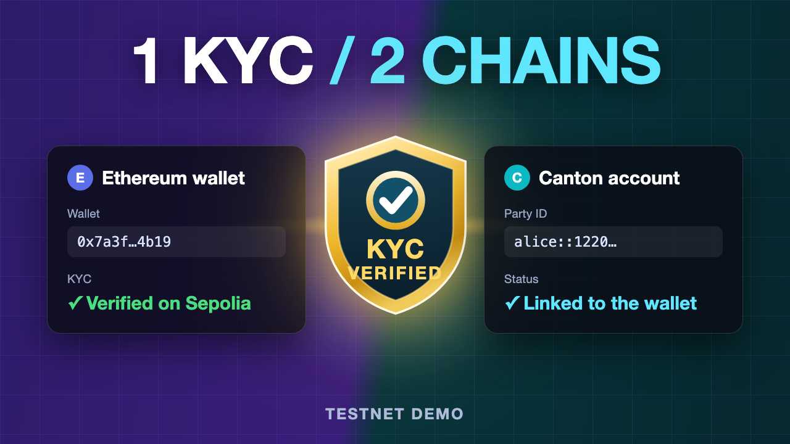

# Onchain Bridges - Canton Integration

**Status:** this runs on Canton **TestNet** and is exercised through the public testnet dApp at
https://rwa-testnet.onchainbridges.com. It is demo-grade and **not audited**. No part of it runs on
Canton MainNet.

  <button type="button" style="border:0;padding:0;background:#000;cursor:pointer;display:block;width:100%;position:relative;border-radius:12px;overflow:hidden">
    
    
      
    
  </button>

Pressing play loads the video from YouTube.

Onchain Bridges is a compliance and interoperability layer for tokenized real-world assets (RWAs).
**This page is Canton-specific**, and it describes one capability: how a KYC verification a holder
has already completed on an EVM chain is recognised for a Canton party that holder has proved
control of.

---

## 1. The capability

**A credential verified on an EVM chain is recognised for a Canton party, without the holder
repeating the verification.**

That is the whole of it. A holder who has completed our KYC journey once, on an EVM chain, can
prove control of a particular Canton party by signing with its key. That party is then recorded in
the same identity record as the verified EVM wallet, and our service will recognise it.

Why it matters: a holder who moves between chains should not have to repeat an identity check they
have already passed, and the applications they deal with should not each have to run their own.

---

## 2. What the holder does

1. Completes the KYC journey once, on an EVM chain. This is the existing journey, unchanged.
2. Proves, on our signer page at `canton-signer.onchainbridges.com`, that they control the Canton
   party they are claiming.
3. That party is then recorded in the same identity record as the verified EVM wallet.

Step 2 happens **off the ledger**: the holder sends no transaction and pays no gas.

---

## 3. The signing key on the signer page

A Canton party can be created on our signer page, in the holder's own browser. That page states,
verbatim:

> "Your signing key is created in this browser and is never sent to any server. It leaves the
> browser only inside your backup file, encrypted with your passphrase - keep that file safe."

**Scope:** that describes a key created on the signer page. It does not describe any Canton party
that was not created on the signer page, including parties hosted on a participant node, ours or
another operator's; key custody for such parties is whatever their own creation and hosting
arrangements provide.

---

## 4. How current the recognition is

The recognition is not a flag written once and then trusted. **Status is checked at the time of each
request**, by reading the holder's verification status on the chain that holds it (the Sepolia
testnet).

That status read is the only part of this that is current by construction. It is not a revocation
mechanism.

---

## 5. Where to see it

The flow runs in the public testnet dApp at https://rwa-testnet.onchainbridges.com, with the Canton
party proof on the signer page named in section 2.

